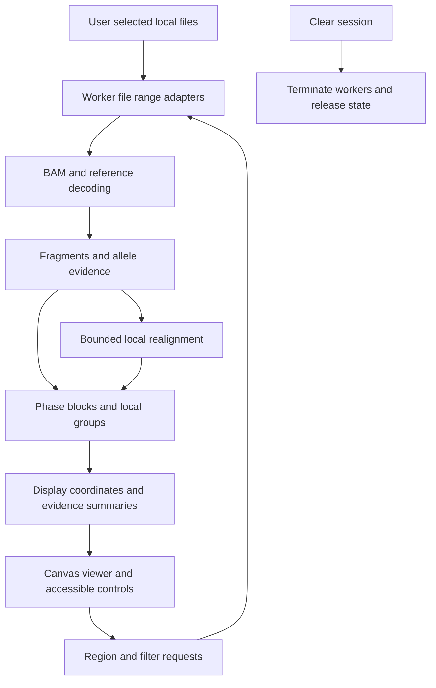

# Phase local clone viewer implementation plan

Draft dated November 10, 2026.

Build a standalone browser application for inspecting read-supported local haplotypes within a gene or genomic interval. It will open local BAM, index, and reference files, identify informative variants, group compatible fragments, and show both the original genomic alignment and an expanded local alignment around complex events. Patient data and analysis state will remain in browser memory for the current session.

The implementation must use HTML, CSS, and JavaScript only. The confirmed first target is paired-end short-read DNA sequencing, including exome and amplicon data. WebAssembly is excluded, including inside dependencies. No application server, localhost server, external data transfer, runtime downloads, or persistent application storage is permitted.

## 1 Product boundaries and interpretation

### What the viewer will answer

- Which variants are observed together on the same sequenced fragment?
- Which local haplotype patterns are supported, by how many usable fragments, and over which positions?
- Where does evidence stop, conflict, or become too ambiguous to connect phase blocks?
- Can bounded local realignment explain a cluster of mismatches or soft clips as a shared insertion, deletion, or candidate tandem duplication?
- How does each proposed local sequence relate back to the selected reference assembly?

Use **local haplotype group** as the primary result label. A tumor clone can contain multiple homologs and copy-number states; normal-cell contamination, allelic imbalance, and sampling can change observed proportions. Different groups therefore do not establish different cellular clones, and group proportions are not cancer-cell fractions. Show the number of supported local patterns per block, unresolved fragments, and alternative explanations. Do not produce a definitive clone count or force the sample into two haplotypes.

For two selected variants, display the observed allele combinations and denominators. Use statements such as “alternate alleles observed together” or “alternate alleles observed on separate supported patterns.” Reserve a categorical trans interpretation for a separately validated diploid model with sufficient evidence; the default mixed-sample mode will not infer trans merely because no fragment contains both alternate alleles. No bridge across a gap means **unphased**, regardless of visual similarity or allele frequency.

### Release scope

The complete first release includes local indexed BAM access, reference comparison, automatic candidate discovery, optional supplied variants, fragment-aware grouping, explicit phase boundaries, an IGV-like pileup, and bounded structural-event realignment with an expanded coordinate view. Structural visualization is a required delivery stage, not an optional future feature.

Exclude chromosome-wide phasing, clonal phylogeny, validated tumor purity or copy-number estimation, remote BAMs, CRAM, RNA sequencing interpretation, long-read optimization, joint analysis across cases, saved sessions, and automatic exports. Files already on disk remain unchanged. The viewer is an evidence inspection tool; clinical use would require a separate validation program for the intended assay and workflow.

## 2 Inputs and offline reference data

| Input | Initial behavior | Validation and failure behavior |
| --- | --- | --- |
| Coordinate-sorted BAM plus BAI or CSI | Required; select both from disk | Validate signatures, header, supported records, reference dictionary, index structure, chunk bounds, and sampled query consistency. Reject missing or unusable indexes without scanning the whole BAM. |
| Local reference sequence | Require a selected `.2bit`, or uncompressed FASTA plus `.fai` | Read only requested ranges; reject missing contigs, out-of-range requests, or incompatible reference sequences. |
| Gene annotation | Ship a small, versioned hg19 gene/transcript catalog inside the application; support hg38 as a separate embedded catalog | Record source, release, assembly, checksums, and redistribution terms. Resolve aliases locally and ask the user to select among ambiguous loci/transcripts. |
| Gene or genomic interval | Gene symbol search or explicit coordinates | Use the gene span by default, with selectable transcript, exon focus, and bounded flanking sequence. Keep genomic gaps visible even when introns are visually collapsed. |
| Optional candidate variants | Local VCF, or a small manual coordinate/allele table | Select sample when applicable, verify reference alleles, normalize supported small variants, and flag unsupported symbolic alleles. Never require heterozygous diploid genotypes in mixed-sample mode. |
| Optional target or primer intervals | Local BED and a clearly selected coordinate convention | Mark capture boundaries and primer-overlapping observations; never assume a generic BED represents primer sequences. |

BAM's indexed access, BAI, coordinate conventions, CIGAR fields, and alignment flags are defined by the [SAM/BAM specification](https://samtools.github.io/hts-specs/SAMv1.pdf); the related [CSI specification](https://samtools.github.io/hts-specs/CSIv1.pdf) covers CSI. Implement adapters against these formats rather than interpreting a gene as one contiguous read stack.

Interpret the request's “18-19” and “18-38” as hg19 and hg38. Default the interface to **hg19**, but make the exact reference identity explicit. hg19, GRCh37-derived references, and references with decoys or alternate contigs must not be silently treated as interchangeable. Validate relevant sequence lengths and available `M5` digests; when identity cannot be fully established, show that status and require an explicit reference selection. A confirmed sequence conflict blocks analysis of the affected interval. Contig aliases such as `chr17` and `17` require a unique validated mapping.

A two-bit file supplies reference sequence, not gene coordinates. Keep the sequence reader and gene catalog separate; the [UCSC two-bit specification](https://genome.ucsc.edu/FAQ/FAQformat.html#format7) describes random access and masked/unknown sequence blocks. A user selects their local reference each session. The application must never fetch reference bases or query a public gene service. Reference acquisition can happen independently before using the viewer, with no case data involved.

Internally use zero-based, half-open intervals. Display conventional one-based genomic coordinates, identify BED and VCF conventions at import, and test all conversions. Gene strand affects annotations and optional sequence orientation; genomic coordinates stay consistent.

## 3 Standalone packaging and architecture

### Runtime package

Produce a single self-contained `phase.html`, opened directly with `file://`. Embed CSS, bundled classic JavaScript, the gene catalogs, and the worker source. Build a dedicated worker from an embedded, immutable source string using a Blob URL. Do not use runtime module imports, `fetch()` for adjacent files, or worker imports that depend on a web origin. Large genomic references stay outside the HTML and are selected through file inputs.

Use a development bundler only to generate the distribution artifact. Node, a package manager, and any development test server are developer tools, not application runtime requirements. The acceptance path must exercise the actual file opened directly from disk. No service worker or installable PWA cache is needed.

The first technical spike must prove that the final packaging, CSP, Blob worker, and selected-file access coexist in the supported browsers. Target desktop Chromium first; add Firefox only after the same checks pass. Record exact browser versions in release validation. Do not weaken the security policy or add a server as an unannounced workaround.

### Component responsibilities



Keep parsing, decompression, allele extraction, grouping, and alignment in a dedicated worker. Send compact typed arrays and immutable summaries to the UI; request read detail on demand. Use ordinary message passing and transferable buffers. Avoid shared memory and requirements for cross-origin isolation.

Each job carries a session ID, region ID, parameter version, and request ID. Discard stale results after navigation, filter changes, cancellation, or reset. Keep cancellable work batches short; a watchdog can terminate and recreate a stuck worker. Apply independent limits to compressed bytes, decoded records, alignment cells, graph paths, and retained memory.

### Dependency decisions

| Area | Proposed implementation | Acceptance gate |
| --- | --- | --- |
| BAM and index reader | Evaluate `@gmod/bam` behind a local-only adapter | Pin an audited version; prove browser File/Blob access, BAI/CSI behavior, bounded caches, and a completely JavaScript decompression path. |
| Local file ranges | Minimal `File.slice()` adapter, or an audited Blob adapter | Expose only byte reads from selected Files, without URL constructors or remote fallbacks. |
| Reference readers | Evaluate `@gmod/twobit`; implement a small FASTA/FAI adapter | Check endianness, unknown/masked blocks, line endings, chunk boundaries, and transitive dependencies. |
| BGZF decompression | Audited JavaScript inflater if the chosen reader requires one | Test independent BGZF blocks, truncation, checksums where supported, and strict expansion limits; exclude native/WASM helpers. |
| Viewer | Canvas 2D with DOM controls and a detail table | Virtualized reads, stable hit testing, keyboard inspection, and no external assets. |
| Phasing and local alignment | Small, independently testable JavaScript modules | Validate against synthetic truth and independent offline methods before interpreting biological data. |

The [GMOD BAM project](https://github.com/GMOD/bam-js) documents BAM/BAI/CSI parsing and browser filehandle integration. [GMOD two-bit](https://github.com/GMOD/twobit-js) is a candidate reference reader. These are candidates rather than committed dependencies: audit the exact version and entire dependency tree, especially decompression. If a reader depends on WASM, replace that path behind the adapter or choose a verified JavaScript version; do not silently relax the requirement. Avoid adopting all of IGV merely to reproduce the pileup interaction.

## 4 Read retrieval and evidence preparation

1. **Resolve the region.** Translate the chosen gene/transcript to genomic intervals and add configurable, bounded flanks. Query windows and deduplicate records returned by overlapping index chunks. Retain the original mapping and file-record identity.
2. **Validate sample selection.** Inspect read-group/sample metadata without displaying patient identifiers by default. Select one sample when multiple samples exist; partition evidence by read group where library differences matter. Do not merge independent samples.
3. **Apply transparent filters.** Initial proposed analysis defaults are MAPQ at least 20 and base quality at least 20. Exclude unmapped, QC-failed, duplicate-marked, and secondary records from primary counts. Keep excluded records inspectable in a separate layer. Treat unavailable MAPQ or base quality as unknown rather than high confidence. Thresholds remain provisional until benchmarked.
4. **Build fragments.** Pair reads using sample/read-group identity and query name, with checks for first/second segment, mate coordinates, and flag consistency. Never pair by query name alone across libraries. Within a fragment, agreeing overlapping observations count once; comparable-quality conflicts become unknown. Missing mates remain single-ended evidence. Retrieve relevant mates by indexed positions within a configured budget; never scan the BAM to recover distant mates.
5. **Separate alignment records from independent evidence.** Retain supplementary records for breakpoint analysis and reconstruct supported query segments, but count a template once. Do not add an independent vote for each split segment. Use relevant tags according to the [SAM tag specification](https://samtools.github.io/hts-specs/SAMtags.pdf).
6. **Handle assay artifacts.** Duplicate filtering remains visible and configurable because coordinate duplication is common in amplicon assays. Without validated UMI handling, call counts “fragments,” not unique molecules. Initially inspect UMI tags without collapsing families. Primer masking requires supplied primer metadata; flag read-end, strand, and primer-associated bias.
7. **Extract alleles against the selected reference.** Decode CIGAR with correct consumption of query/reference coordinates. Distinguish insertions, deletions, reference skips, soft clips, and hard clips. Normalize supported indels within bounded reference context, retaining the original representation. Honor BAM sequence orientation; test reverse-strand records explicitly. `MD` may help cross-check, but cannot replace the selected reference and complete CIGAR interpretation.

The mate connector represents a physical fragment relationship, not sequenced bases across the insert. Both ends can link variants they actually observe; the unsequenced middle remains unknown. Similarly, hard-clipped bases cannot be reconstructed from a record that does not contain them.

## 5 Variant discovery and phasing

### Candidate variants and evidence matrix

Support two complementary inputs: supplied variants of interest and automatic local discovery from quality-filtered observations. Without a VCF, discover SNVs and supported small indels from the BAM/reference comparison so the basic workflow remains BAM plus reference plus gene.

Retain every supplied variant in the inspection table, even with zero coverage or insufficient support. For automatic discovery, start with at least three supporting fragments and configurable allele-fraction and bias filters. This is an exploration threshold, not a validated limit of detection. Keep weak evidence visible without allowing it to create unrestricted new groups. Mark repetitive, low-complexity, and ambiguous-reference contexts.

Represent each fragment as a sparse vector across informative sites with states `reference`, a specific alternate allele, `unknown`, or `conflict`. A fragment that does not cover a variant has an unknown value, never a reference vote. Preserve multiallelic sites and avoid counting overlapping variant representations as independent events. Reconcile complex overlapping alleles through a shared local sequence model or leave them unresolved.

### Evidence graph and phase blocks

Build a graph of informative sites connected by usable fragments that observe both sites. Store full fragment patterns as well as pairwise allele-combination counts. Pairwise edges summarize evidence; they must not create an unobserved whole-gene haplotype through transitive closure.

Begin with connected components, then identify weak bridges and contradictory links. Default to at least three independent usable fragments supporting a bridge, with explicit contrary counts and quality summaries; validate or adjust this threshold using fixtures. A single strong read may be shown as a possible link but does not silently merge two established blocks. Report direct co-observation separately from connections inferred through several intermediate variants.

Coverage gaps, sites without informative observations, and insufficient bridges create explicit boundaries. A zero-coverage gap need not end a block if the two sequenced ends of reliable fragments establish linkage across it. Conversely, continuous coverage does not establish phase when no usable fragments connect informative sites. Each boundary records its actual cause.

### Group reconstruction without a fixed ploidy

Implement a conservative, bounded reconstruction strategy:

1. Seed candidates from distinct high-quality observed fragment patterns, preserving their covered positions.
2. Extend candidates only through informative overlap supported by fragments. Do not merge groups through entirely missing positions or through a chain of merely compatible partial patterns.
3. Score fragment-to-candidate assignments using quality-weighted allele likelihoods over observed sites. Cap quality influence and retain mapping/bias summaries; do not claim a calibrated probability from raw base qualities alone.
4. Iteratively reassign fragments and update local consensus within explicit candidate and iteration limits. Add or split a group only when repeated discriminating evidence improves the fit beyond a complexity penalty. Select provisional penalties on synthetic mixtures, including minor patterns and error-only controls.
5. Preserve near-equivalent explanations and ambiguous assignments. A fragment with no distinguishing sites can support coverage without being assigned to one group. An excess of candidates or equally supported decompositions produces “unresolved mixture,” not an arbitrary best clone count.
6. Run stability checks under reasonable filter changes and deterministic resampling. Label these stability measures rather than clinical confidence probabilities. Retain conflicting fragments and explain why each is unresolved.

For a small number of informative sites, enumerate bounded candidate paths and compare reconstruction against exact solutions as a test oracle. For larger components, use the bounded heuristic and surface truncation. Avoid all-pairs read alignment and exponential whole-gene haplotype enumeration. Cache equivalent allele patterns for computation while retaining all underlying fragment identities and counts.

Show each group's defining alleles, covered positions, distinguishing fragment count, compatible but ambiguous count, quality/bias warnings, and membership strength. At a selected variant pair, show the reference/reference, reference/alternate, alternate/reference, and alternate/alternate counts when biallelic; expand the table for multiallelic cases. Denominators must include only fragments informative for the particular comparison. A block-wide assignment fraction is conditional on the analyzed fragments and cannot substitute for a local allele fraction or tumor clone proportion.

Existing diploid phasers can provide an independent benchmark on suitable fixtures. [WhatsHap's guide](https://whatshap.readthedocs.io/en/stable/guide.html) describes read-based phasing and its scope; do not assume its diploid behavior or structural-variant limitations solve the mixed-sample reconstruction proposed here. Benchmark tools run only in development, never as application services.

## 6 Local realignment and structural events

### Bounded event analysis

Trigger local analysis around repeated soft-clip anchors, indel clusters, consistent supplementary alignments, or discordant pairs. Require a selected bounded interval with flanking anchors. Keep every result linked to original records so the original alignment remains inspectable.

Use affine-gap, banded read-to-candidate alignment in JavaScript for small windows. Initially construct candidates from normalized indels and compatible clip consensuses. For more complex events, implement bounded overlap or partial-order assembly of supporting read segments, preserve alternative paths, and realign original fragments to candidate paths. Mates contribute linkage constraints but do not contribute invented sequence across their insert. Candidate scoring must compare alternate explanations with the reference and preserve unresolved repeat mappings.

Provisional starting limits are a 5 kb assembly window, a 1 kb inserted sequence, 32 candidate paths, and a fixed alignment-cell/time budget. These are configurable safety and performance bounds to measure in the initial spike. They are not a biological claim that larger events are absent. Larger events can retain breakpoint or split-read visualization while being labeled “outside local reconstruction limits.”

Promote an event to a supported local hypothesis only with repeated consistent fragment evidence, usable anchors, and adequate uniqueness. Show strand/read-position bias, supporting and contradicting counts, and confidence in both breakpoint placement and inserted sequence. Similar soft clips alone do not establish a duplication. A tandem-duplication label requires a supported local junction and sequence consistent with a repeated reference segment; otherwise label it as an insertion or unresolved event hypothesis. Do not claim absolute copy number or resolve a distant rearrangement from a local pileup.

### Expanded display coordinates

Maintain two independent coordinate systems: immutable genomic coordinates and a local display axis. Give the latter an explicit, reversible map:

- Reference-backed columns map to contig and genomic position.
- Inserted columns map to an anchor, event ID, and insertion offset, with no fictitious genomic coordinate.
- Repeated sequence maps to its source interval plus a candidate copy ordinal; distinguish copies on the display axis.
- Deleted sequence remains present on the genomic reference axis and appears as a gap along the candidate path.
- Collapsed gaps retain genomic length and an expansion control.

For an insertion, both the top and bottom reference tracks show a gap opposite inserted columns. For a tandem duplication, show the extra sequence on its event path and annotate its source interval and junction. For mutually incompatible events, use separate event panels with synchronized anchors rather than forcing all alternatives into one misleading linear consensus.

Example for a supported insertion between two genomic anchors:

```text
Genomic reference     A C G - - - T A C
Group H1              A C G - - - T A C
Group H2              A C G G G A T A C
Genomic reference     A C G - - - T A C
                            ^ inserted columns
```

Switch between genomic pileup and expanded local alignment without altering the source BAM. In the expanded view, color raw mismatches relative to the genomic reference, distinguish agreement with the candidate consensus, and keep the two comparison modes clearly labeled. Local consensus must never make a true reference difference disappear from interpretation.

## 7 Viewer and interaction design

Use a horizontal genomic view with the following synchronized tracks:

1. Gene/transcript overview with exon boundaries, coverage, and phase-block extents.
2. Genomic ruler and reference sequence at the top; repeat the reference at the bottom of expanded local alignments.
3. Candidate variant markers and a pair-selection control for inspecting linkage.
4. Coverage and allele summaries calculated from the stated fragment/filter population.
5. Collapsible local haplotype groups, each showing consensus, defining alleles, support, and read/fragment rows.
6. A distinct ambiguous/conflicting/unassigned section and a toggle for excluded records.
7. An evidence panel with allele-combination counts, bridge evidence, original CIGAR/mate details, and event hypotheses.

Render matching read bases in gray. Use stable A/C/G/T colors for mismatches, an insertion symbol with expandable sequence, deletion lines, and a neutral dedicated soft-clip color by default. Reveal clipped bases on demand instead of displaying a distracting rainbow. Group color belongs in the group header or narrow row marker, so it does not compete with nucleotide color. Use glyphs, labels, and outlines as well as color.

Keep group identities stable while panning within a computed block; do not imply group identity across disconnected blocks. Allow sorting by group, selected variant, start position, strand, or mapping quality. A “sort by allele” action is a display action; it must not recalculate biological grouping. Zoomed-out views aggregate support; base-level views expose individual records. Read names and sample identifiers appear only on explicit inspection and remain plain text.

Use Canvas for dense tracks and virtualize off-screen rows. Provide keyboard navigation, a DOM evidence table, visible legends, readable contrast, and high-DPI support. Show processed/eligible/rendered counts and whether the view is complete, running, limited, or unresolved. Cancel and Clear session remain available during analysis.

## 8 Privacy and security controls

### Application guarantees

- Open only user-selected Files using range reads. Never request directory-wide access or retain filesystem handles.
- Keep case data, filters, derived sequences, reference caches, and preferences in RAM. Do not use localStorage, sessionStorage, IndexedDB, cookies, Cache Storage, OPFS, service workers, or saved-session URLs.
- Bundle dependencies, catalogs, fonts or system-font choices, icons, and other assets. No CDNs, analytics, error-reporting endpoints, remote reference lookups, update checks, WebSockets, beacons, WebRTC, preconnects, or external navigation inside an active case.
- Exclude export/download/clipboard functions from the first release. If explicitly requested later, treat them as deliberate local persistence and review their scope separately.
- Never log read names, sample headers, file paths, sequence content, or case details to the console. Keep diagnostic counters generic and volatile.

### Content and execution restrictions

Place a meta Content Security Policy before executable content. Generate hashes for the fixed inline application script and styles. Start from this policy template, replacing placeholders during packaging:

```text
default-src 'none';
script-src 'sha256-APP_HASH';
script-src-attr 'none';
style-src 'sha256-STYLE_HASH';
style-src-attr 'none';
worker-src blob:;
connect-src 'none';
img-src 'none';
font-src 'none';
object-src 'none';
base-uri 'none';
form-action 'none';
frame-src 'none';
media-src 'none';
manifest-src 'none';
```

Use Canvas-drawn icons and system fonts to avoid asset exceptions. Do not permit `unsafe-eval`, unrestricted inline scripts, or WASM evaluation. Create Blob workers only from fixed bundled source, never from imported content. Verify inherited restrictions and blocked networking inside the worker in each supported browser. Use classes and Canvas properties rather than arbitrary inline CSS.

The [CSP specification's meta delivery rules](https://w3c.github.io/webappsec-csp/#meta-element) have limitations compared with HTTP headers. Do not claim that `frame-ancestors`, sandboxing, navigation control, or a generic no-network guarantee follows from this meta policy. Treat CSP as one layer alongside a small audited application, no URL-bearing features, dependency review, and external network observation. Browser/OS network isolation can supply stronger deployment enforcement without changing the application.

Render BAM headers, query names, gene labels, filenames, and imported text with text-only APIs. Do not use `innerHTML`, dynamic code generation, user-supplied SVG/HTML, imported scripts, or active links derived from data. Validate file offsets, counts, integer ranges, maximum sequence and tag lengths, compressed expansion, and allocation sizes before use. Reject truncated or malformed inputs with generic errors and preserve an operable reset path. Put the same limits around annotation and optional VCF/BED parsers.

### Session disposal and limits of the guarantee

Clear session must cancel jobs, terminate workers, release file and buffer references, revoke Blob URLs, clear file inputs and Canvas pixels, remove derived DOM content, and create a new empty session ID. Best-effort buffer overwrites can precede release where practical. Clear on page exit; when a page is restored from the browser back/forward cache, force an empty session rather than resuming retained data. Test reload, navigation, close/reopen, and browser session restoration without relying solely on unload handlers.

The application can guarantee that it deliberately writes no case data to persistent application storage and initiates no outbound communication. JavaScript cannot guarantee physical RAM erasure, prevent browser/OS swap or crash artifacts, neutralize malicious extensions, or control cloud synchronization of files the user already selected. State this boundary accurately in deployment documentation; do not advertise forensic erasure or certification from a browser-only design.

## 9 Resource limits and complete evidence

Read indexed byte ranges with the [File/Blob API](https://w3c.github.io/FileAPI/) rather than loading a multi-gigabyte BAM or reference into memory. Bound per-session caches by bytes, retain the active region, and evict earlier regions on navigation. Track decoded data and reconstruction memory separately.

Proposed initial engineering targets, to benchmark on a documented 16 GB development machine:

| Operation | Initial target |
| --- | --- |
| Usable first pileup for 20 kb with up to 10,000 150 bp read pairs | Within 3 seconds after file/header setup |
| Local grouping for that fixture | Within 10 seconds with progress and cancellation |
| Rendering | At least 30 frames per second during typical pan/zoom; virtualize rows |
| Cancel/reset | Acknowledge within 250 ms; terminate a worker if cooperative cancellation stalls |
| Active analysis budget | Start with 512 MiB of explicitly accounted buffers/caches; measure actual browser process peak separately |

These are targets, not measured performance claims. Set record and assembly budgets based on the spike. Never silently sample analytical evidence to fit a target. Rendering can select representative rows only when the viewer shows rendered versus total counts and provides access to the rest. If an analysis limit is reached, show partial counts and disable complete-result interpretations; offer a narrower interval, explicit filter changes, or an explicitly labeled exploratory sample. Whole-gene overview tiles must not be presented as phase links between independently analyzed windows.

## 10 Proposed repository structure

```text
phase/
  IMPLEMENTATION_PLAN.md
  README.md
  package.json
  src/
    index.html
    styles.css
    app.js
    session.js
    workers/analysis-worker.js
    io/                    # local File adapters, BAM/index/reference readers
    annotation/            # gene and transcript lookup, contig mapping
    evidence/              # CIGAR, fragments, alleles, candidate discovery
    phasing/               # blocks, patterns, assignments, stability
    realignment/           # local candidates, alignment, event hypotheses
    coordinates/           # genomic and expanded-axis maps
    viewer/                # tracks, layout, canvas, hit testing, DOM tables
    security/              # validation, budgets, safe text handling
  references/              # public catalog manifests and licenses only
  scripts/                 # build, CSP hashes, dependency and bundle checks
  tests/
    fixtures/              # tiny synthetic files and expected results
    unit/
    integration/
    browser/
    security/
  dist/phase.html           # generated standalone release artifact
```

Use JavaScript modules in source and a bundled classic script in the release. Keep binary fixtures synthetic and small. Never commit case BAMs, private annotations, patient screenshots, runtime reports, or real patient-derived sequence.

## 11 Delivery stages and acceptance gates

### Stage 0 Prove offline packaging and JavaScript feasibility

Build the smallest standalone file that opens a synthetic BAM/index and reference, queries a region in a Blob worker, and draws reads. Audit candidate dependency licenses, networking, dynamic code execution, and WASM. Generate CSP hashes and verify worker behavior. Measure decompression, range reading, peak memory, and cancellation on representative small/large fixtures.

**Gate:** direct `file://` launch, JavaScript-only dependencies, no server, zero observed application network attempts, and no persistent case state. Resolve compatibility failures here before building the main analysis engine.

### Stage 1 Deliver an accurate reference pileup

Implement session setup, assembly/reference validation, local gene lookup, BAM/BAI/CSI adapters, reference access, coordinate conversion, coverage, CIGAR rendering, fragment construction, and basic filters. Support both two-bit and indexed uncompressed FASTA through the same sequence interface.

**Gate:** correct base, insertion, deletion, clip, mate, and reverse-strand rendering against synthetic truth; indexed I/O without whole-file loading; failures for incompatible references and unusable indexes; responsive reset.

### Stage 2 Deliver transparent local phasing

Implement automatic SNV/small-indel discovery, optional supplied variants, the fragment-by-allele matrix, evidence graph, phase boundaries, unrestricted group count within budgets, ambiguous assignments, pair evidence tables, and the grouped pileup.

**Gate:** reproduce known local patterns in two-pattern and multi-pattern fixtures; do not join disconnected blocks, treat uncovered sites as reference, double-count mates, or equate groups with clones. Return unresolved alternatives when reconstruction is not identifiable.

### Stage 3 Deliver structural-event realignment

Implement bounded candidate generation, affine-gap alignment, clip consensus, repeated-sequence alternatives, breakpoint support, expanded coordinates, dual reference tracks, and links back to the original pileup. Add the bounded assembly path for supported cases that simple indel candidates cannot explain.

**Gate:** correct expanded alignment for an insertion, deletion, and tandem duplication; reversible hit testing; preserved reference differences; unresolved status for ambiguous repeats and unsupported rearrangements. Meet budgets without silently truncating biological interpretations.

### Stage 4 Validate performance, privacy, and interpretation

Complete virtualized rendering, accessibility, assay/bias controls, resource-limit UI, malformed-input defenses, lifecycle tests, and independent comparisons. Freeze a versioned parameter preset only after the fixtures justify it. Package a release with checksums, dependency notices, supported browser versions, and a plain-language security boundary.

**Gate:** all tests below pass on the actual standalone artifact. No clinical validation claim follows merely from passing engineering tests.

## 12 Validation matrix

| Test family | Required cases and expected result |
| --- | --- |
| Formats and coordinates | BAI and CSI, missing/wrong index, truncation, BGZF boundaries, chromosome aliases, negative-strand genes, coordinate edges, long/malformed CIGARs and tags; safe errors and exact positions. |
| Read evidence | Reverse reads, agreeing/conflicting overlapping mates, missing/distant mates, duplicate flags, secondary/supplementary records, repeated names in different read groups, unavailable quality; no inflated support. |
| Basic phase | Known co-occurring alternates; separate patterns with both reference and alternate observations; one-site fragments; disconnected exons; paired-end bridges; adequate coverage with no linkage; correct block boundaries and counts. |
| Mixed samples | Three or more local patterns, low-frequency supported pattern, error-only apparent pattern, normal/tumor mixture, allelic imbalance and copy-number-like mixtures; no fixed diploidy or inferred cellular clone fractions. |
| Identifiability | Different full haplotype sets explaining the same partial observations, weak bridges, contradictions, repeat ambiguity; retain alternatives and unresolved labels. |
| Complex alleles | Small indels, overlapping normalized representations, tandem repeats, clip-supported insertion, deletion, local tandem duplication, incompatible event paths; correct axes and no fabricated reference coordinates. |
| Assay artifacts | Amplicon duplication, primer-associated mismatch, strand/read-end bias, capture gaps, high depth; transparent filters and no automatic unique-molecule claims. |
| Resource handling | Large BAM with a small query, extreme depth, long gene, candidate explosion, oversized compressed records; bounded work, responsive cancellation, explicit partial-result state. |
| Malicious content | HTML/script-like names, hostile annotation/VCF labels, corrupt counts and offsets, expansion bombs; no execution, network, persistent state, or browser hang from unbounded work. |
| Session lifecycle | Clear during analysis, replace files, reload, back/forward restore, close/reopen, crash recovery where testable; stale results rejected and no restored case state. |
| Network and storage | Fresh browser profile, actual file artifact, UI and worker API instrumentation plus browser network events; no attempted outbound requests and no persistent application storage. Repeat while physically offline. |
| Visual interaction | Genomic/expanded view snapshots, top/bottom reference alignment, row virtualization, high DPI, keyboard inspection, ambiguous group styling; accurate selection and stable labels. |

Generate truth fixtures from known reference segments, haplotypes, fragment placements, and controlled errors. Compare parser/pileup counts against offline samtools and suitable diploid cases against an independent phaser. Those comparisons run only during development with synthetic/public non-sensitive fixtures and do not introduce runtime dependencies. Use held-out fixtures for parameter selection and report false phase links, missed links, spurious/missed groups, assignment ambiguity, and structural breakpoint/sequence accuracy within the declared scope. Differential agreement alone is not proof of truth.

For storage testing, combine source/dependency review, interception of persistence APIs, and browser profile inspection. For network testing, fail on attempted outbound access even when CSP or offline mode blocks it. Test worker and main-thread paths separately; an offline successful run alone does not prove absence of attempted transfer. Keep release testing independent of any development web server.

## 13 Remaining design defaults

The sequencing target and JavaScript-only requirement are confirmed. Proceed with the following defaults unless later changed:

- One case/sample per session; multiple read groups may contribute within that sample.
- hg19 first, hg38 through the same validated interfaces; local reference selection every session.
- Automatic candidate discovery plus optional supplied variants; no VCF prerequisite.
- Conservative mixed-sample interpretation, fragment counts, and unresolved alternatives.
- Chromium as the initial supported browser, then Firefox after equivalent validation.
- No export, saved preferences, session restore, or application-managed persistent data.
- No biological promise beyond available fragment linkage and the declared local reconstruction limits.

The first implementation task is Stage 0. Its outcome determines the audited dependency versions, measured budgets, and browser support before the analysis modules are built.
